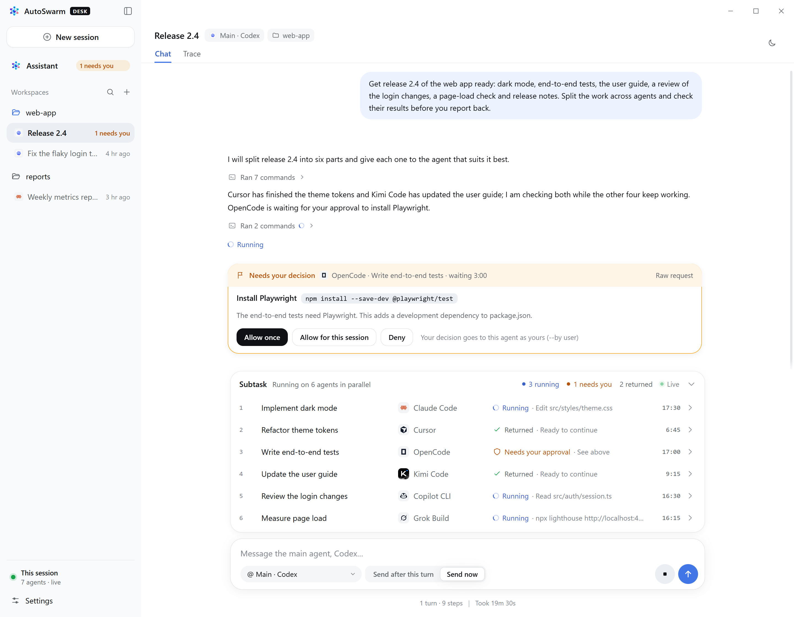

# AutoSwarm Desk

English · [中文](README.zh-CN.md)

AutoSwarm's desktop app for Windows and macOS: talk to a private assistant and start main conversations in one window, see how your agents split and share the work, answer their approvals and questions, and get notified when something needs you.



Desk is just one user of the AutoSwarm CLI. Without Desk, AutoSwarm still works as a plugin (Skill + CLI) inside any agent; the boundary between the two is described in "Plugin core and Desk" in [docs/architecture.md](../docs/architecture.md).

## Getting started

**Install**: download [AutoSwarm-Desk-Setup.exe](https://github.com/HKUDS/AutoSwarm/releases/latest/download/AutoSwarm-Desk-Setup.exe) and run it. It installs for the current user without administrator rights, adds Start menu and desktop shortcuts, and opens Desk. Python is included; the agents themselves are installed and signed in as usual. The installer is not code-signed, so Windows SmartScreen may warn the first time: choose More info → Run anyway. Desk reads AutoSwarm's record directory (`%LOCALAPPDATA%\autoswarm`, or `AUTOSWARM_HOME`); another one can be chosen in Settings.

**Updates**: Desk looks for a new version when it starts and every six hours, downloads it in the background and installs it when you quit Desk, or at once with "Restart to update" in the sidebar. Agents' sessions run on Desk's Python, and the installer would stop them, so while any are running the update waits for a later quit. Checks, downloads and these decisions are written to `updates.log` in Desk's data folder. Uninstall from Windows Settings → Apps; records and settings are kept. The AutoSwarm Skills Desk installed into your agents run on Desk's Python, so after uninstalling, set AutoSwarm up again as a plugin (see the main README) to keep using it in those agents.

**macOS**: download [AutoSwarm-Desk-mac-arm64.dmg](https://github.com/HKUDS/AutoSwarm/releases/latest/download/AutoSwarm-Desk-mac-arm64.dmg) for Apple silicon (M1 and later) or [AutoSwarm-Desk-mac-x64.dmg](https://github.com/HKUDS/AutoSwarm/releases/latest/download/AutoSwarm-Desk-mac-x64.dmg) for Intel Macs, open it and drag AutoSwarm Desk to Applications. Python is included. Desk is not signed with an Apple Developer ID, so the first time macOS says it cannot verify the app: choose Done, open System Settings → Privacy & Security, choose Open Anyway next to “AutoSwarm Desk” was blocked (under Security), and confirm with your password or Touch ID. The first notification asks whether Desk may send notifications: choose Allow to be alerted about approvals and questions. Desk finds your agents and the API keys your shell profile exports, as in Terminal, even when opened from Finder or the Dock. Records are in `~/Library/Application Support/autoswarm` (or `AUTOSWARM_HOME`). Closing the window keeps Desk in the menu bar; click the Dock icon to open it again. A Mac copy does not update itself: the sidebar links to a new version when there is one.

**Without installing**: each release also has `AutoSwarm-Desk-<version>-win-x64.zip`; unzip it and run `AutoSwarm Desk.exe`. This copy does not update itself; the sidebar links to a new version when there is one.

**From source** (Node.js 20+, Python 3.10+):

```powershell
cd desktop
npm ci
npm start                                  # or npm start -- --home="D:\AutoSwarm records"
npm run demo                               # sample data, no real agents
```

From source, Desk tries `AUTOSWARM_DESK_PYTHON`, `python`, `py -3` and uv's Python in turn (on macOS `python3`, `python` and uv's, skipping any older than 3.10); one can also be chosen in Settings. To look at the interface only, run `npm run build` and open `renderer/index.html` in a browser (sample data).

## Features

- **Private assistant**: change its agent at any time. Each agent has its own assistant conversation, which continues when you switch back; an agent you switch to is given the titles and session IDs of the earlier conversations and reads their latest exchanges when needed.
- **New conversations**: choose the main agent, the working directory, the model and reasoning effort (lists the agents report themselves: the menu shows the last list at once and reads it again in the background; it can also be refreshed), the permission level (Claude Code, Codex, Cursor, named as each agent names its own) and the AutoSwarm switch (an agent gets the Skill installed the first time it is chosen).
- **Conversations and workers**: the sidebar lists main conversations; workers appear in their conversation's worker panel. While an agent runs, its text is shown and tool calls fold into one row; when it finishes, only the final reply stays. Links in replies (web pages, Markdown, HTML, PDF, files) open in tabs in the side panel.
- **Approvals and questions**: cards show the command to run or the file to change. A worker's requests go first to the agent that started it, which asks you when unsure; Desk never approves for you.
- **Direct messages**: write to a main conversation or any worker, also while it runs, or stop a whole conversation.
- **Tray and notifications**: notified when something waits for you or a conversation finishes or fails; can start in the tray at login. On macOS the icon sits in the menu bar and the count on the Dock icon.
- **Trigger rules**: create `triggers.json` in Settings and write rules as "when + what", for example a notification naming the conversation when Codex waits for approval, no notification when an external conversation finishes, or asking the private assistant to find out why a conversation failed.
- **Settings**: English/Chinese, zoom (Ctrl + = / −, ⌘ on macOS), light/dark, keeping process events, the Python interpreter, and a demo space (left from its banner or the top right at any time).

## Supported agents

Claude Code, Codex, Cursor, OpenCode, Copilot CLI, Muse, CodeBuddy, Hermes, Nanobot, DeepSeek Harness, Grok Build, Kimi Code.

- Model lists are asked of each agent, without a model call: an official login lists that account's models, an agent configured with your own API lists the configured models. Muse has no list; type the model instead.
- Agents slow to list their models the first time (CodeBuddy takes about a minute) are cached afterwards.
- Agents without Desk permission levels keep their own settings; whether they ask before running commands is up to each agent.
- When Codex uses its Windows sandbox, the command that starts workers must run outside the sandbox, which Codex asks you about through its own escalation.

## Data and security

- Desk never copies agents' full histories: the process of Claude Code, Codex and Cursor is read from their own session records; for other agents AutoSwarm keeps it while they run in `calls/<id>/events.jsonl` (up to 64 MB per call).
- Preferences and `triggers.json` live in Desk's data folder (its path is shown under Trigger rules in Settings); only AutoSwarm writes the record directory.
- The interface has no Node access and can call only a fixed set of operations; replies are sanitized before display; pages in the side panel get no permissions; Desk never approves a request automatically.
- On Windows, Desk adds the current user environment from the registry when it starts agents, so agents installed or API keys set after Desk started work without signing out.
- On macOS, Desk asks your login shell for its environment when it starts agents: its PATH comes first, and variables Desk lacks (such as API keys your profile exports) are added.

## How it works

`electron/main.cjs` starts `python -m autoswarm.desk.watch` and passes the record snapshots it prints to the interface. Every action (new conversations, messages, approvals and so on) goes through the AutoSwarm CLI (`autoswarm desk …` and the other commands); Desk never writes the record directory itself. There is no HTTP service or database, and closing the window ends the watcher.

## Development and tests

```powershell
npm test                 # unit tests
npm run test:ui          # other Electron tests: browser visual theme assistant settings preview demo models p2 p3 p4 swarm
npm run pack             # dist/win-unpacked/AutoSwarm Desk.exe
npm run dist             # installer and ZIP in dist/
npm run release          # dist, then the files of one GitHub Release in dist/release
npm run pack:mac         # on a Mac: dist/mac-arm64 and dist/mac (Intel) with AutoSwarm Desk.app
npm run dist:mac         # on a Mac: dmg and ZIP for Apple silicon and Intel in dist/ (npm run dist:mac -- arm64 for one)
npm run release:mac      # dist:mac, then the Mac files of the same release in dist/release-mac
npm run screenshots      # the README screenshots in docs/assets/desk (scene: scripts/readme-scene.mjs)
```

- Release: raise `version` in `package.json` and push the tag `desk-v<version>`. The `Desk release` workflow builds on Windows and attaches the files to a draft release; check it and publish it as the latest release. A release can also be made by hand from `dist/release`. It has five files: `AutoSwarm-Desk-Setup.exe` for people to download, the ZIP, and `AutoSwarm-Desk-Update.exe`, its `.blockmap` and `latest.yml`, which only Desk's automatic update reads. The two copies of the installer let the [download statistics](../docs/download-statistics.md) count downloads and automatic updates apart.

- macOS files: on a Mac, run `npm run release:mac` for the same version and add `dist/release-mac` to the draft release before publishing it (`gh release upload desk-v<version> dist/release-mac/*`). A release published as latest must keep the Windows files, which the READMEs and Windows' automatic update read; a Mac copy is offered only releases that have a `.dmg`. Mac apps are signed ad hoc, not with an Apple Developer ID. `npx electron scripts/make-mac-icons.cjs` redraws the menu bar icons and `packaging/icon.icns` from the logo.

- Run `npm run build` after changing `renderer/*.mjs` (start, test and pack run it automatically).
- Set `DESK_EXECUTABLE` to a packaged exe (on macOS, `AutoSwarm Desk.app/Contents/MacOS/AutoSwarm Desk`) to run the same Electron tests against the package; tests use temporary record and preference folders.
- Do not pack while Desk runs from `dist/win-unpacked`: packing empties that folder.
- Python tests of the Desk backend are in the repository's `tests/desk/` and run with `python -m unittest discover -s tests`.
- Sources and licenses of the agent icons: [docs/assets/agents/NOTICE.md](../docs/assets/agents/NOTICE.md), included in the package under `resources/third-party/agent-icons/`. This project uses the MIT License in the repository root.
