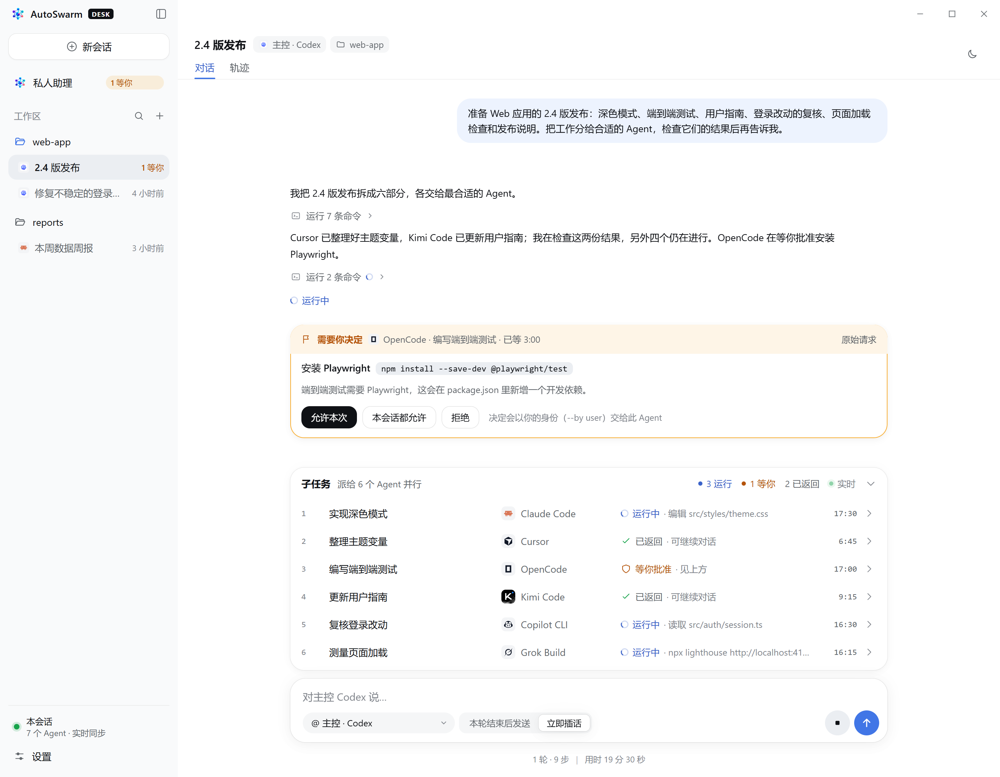

# AutoSwarm Desk

[English](README.md) · 中文

AutoSwarm 的 Windows 桌面应用：在一个窗口里和私人助理对话、直接开主会话，看各个 Agent 如何分工协作，处理它们的审批和提问，并在需要你时收到通知。



Desk 只是 AutoSwarm CLI 的一个使用方。不装 Desk，AutoSwarm 照样以插件方式（Skill + CLI）在任意 Agent 里使用；两者的代码边界见 [docs/architecture.zh-CN.md](../docs/architecture.zh-CN.md) 的「插件核心与 Desk」。

## 开始使用

**安装**：下载 [AutoSwarm-Desk-Setup.exe](https://github.com/HKUDS/AutoSwarm/releases/latest/download/AutoSwarm-Desk-Setup.exe) 并运行。安装到当前用户，不需要管理员权限，会创建开始菜单和桌面快捷方式，装好后自动打开。自带 Python；各个 Agent 仍按原来的方式安装和登录。安装程序没有代码签名，Windows SmartScreen 第一次可能拦截：点「更多信息 → 仍要运行」。默认读取 AutoSwarm 的记录目录（`%LOCALAPPDATA%\autoswarm`，或 `AUTOSWARM_HOME`），可在设置里换。

**更新**：Desk 启动时和之后每六小时检查一次新版本，在后台下载，退出 Desk 时自动安装；也可以点侧栏的「重启并更新」立即安装。Agent 的会话运行在 Desk 自带的 Python 上，安装会中断它们，所以有 Agent 在运行时，更新等到之后再退出时安装。检查、下载和是否安装都记在 Desk 数据目录的 `updates.log` 里。卸载在 Windows「设置 → 应用」里，记录和设置会保留。Desk 为各 Agent 安装的 AutoSwarm 技能使用 Desk 自带的 Python，卸载后如果还要在这些 Agent 里用 AutoSwarm，请按主 README 以插件方式重新安装。

**免安装**：每个版本也提供 `AutoSwarm-Desk-<版本>-win-x64.zip`，解压后运行 `AutoSwarm Desk.exe`。这种方式不会自动更新，有新版本时侧栏会给出下载链接。

**从源码运行**（Node.js 20+、Python 3.10+）：

```powershell
cd desktop
npm ci
npm start                                  # 或 npm start -- --home="D:\AutoSwarm records"
npm run demo                               # 演示数据，不连接真实 Agent
```

源码运行时依次尝试 `AUTOSWARM_DESK_PYTHON`、`python`、`py -3`、uv 的 Python；也可在设置里选择。只想看界面时，先运行 `npm run build`，再用浏览器打开 `renderer/index.html`（示例数据）。

## 主要功能

- **私人助理**：可随时换 Agent。每个 Agent 各有一个助理会话，换回来接着聊；新换的 Agent 能看到之前各会话的标题和会话 ID，需要时读取它们最近的内容。
- **新会话**：选择主 Agent、工作目录、模型和思考强度（列表由各 Agent 自己报告，打开菜单即显示上次的列表并在后台刷新，也可手动刷新）、权限级别（Claude Code、Codex、Cursor，用各家自己的名称），以及 AutoSwarm 开关（第一次选中某个 Agent 时自动为它安装 Skill）。
- **会话与子任务**：侧栏列出主会话，子任务在所属会话的子任务栏里。运行中显示 Agent 的文字，工具调用折叠成一行；结束后只留最终回复。回复里的链接（网页、Markdown、HTML、PDF、文件）在右侧面板的标签页里打开。
- **审批与提问**：卡片写清要运行的命令或要改的文件。子 Agent 的请求先由派它的主 Agent 决定，拿不准时才问你；Desk 不会替你批准。
- **直接对话**：给主会话或任一子任务发消息，运行中也可以插话，或停止整个会话。
- **托盘与通知**：有事等你、会话完成或失败时通知；可开机启动到托盘。
- **触发规则**：在设置里创建 `triggers.json`，按「什么时候 + 做什么」写规则，例如 Codex 等你批准时弹出写清会话的通知、外部会话完成时不弹通知、会话失败时请私人助理查明原因。
- **设置**：中文/英文、缩放（Ctrl + = / −）、深浅色、过程记录另存、Python 解释器、演示空间（横幅或右上角可随时退出）。

## 支持的 Agent

Claude Code、Codex、Cursor、OpenCode、Copilot CLI、Muse、CodeBuddy、Hermes、Nanobot、DeepSeek Harness、Grok Build、Kimi Code。

- 模型列表向各 Agent 询问，不调用模型：官方登录列出账号下的模型，自己配了 API 的列出配置的模型。Muse 没有列表，可直接填写。
- 首次读取较慢的 Agent（CodeBuddy 约一分钟）之后会缓存。
- 没有 Desk 权限级别的 Agent 用它们自己的设置，运行命令前是否询问由各家决定。
- Codex 使用 Windows 沙箱时，派子任务的命令需要在沙箱外运行，会经它自己的提权流程询问你。

## 数据与安全

- Desk 不复制各 Agent 的完整历史：Claude Code、Codex、Cursor 的过程直接读取它们自己的会话记录；其他 Agent 的过程由 AutoSwarm 在运行时保存到 `calls/<id>/events.jsonl`（单个调用超过 64 MB 后不再保存）。
- 偏好和 `triggers.json` 保存在 Desk 的数据目录（路径显示在设置的「触发规则」里）；记录目录只由 AutoSwarm 写入。
- 界面进程没有 Node 权限，只能调用固定的几个操作；回复内容经过清理后显示；右侧面板里的网页没有任何权限；Desk 不会自动批准任何请求。
- 在 Windows 上，Desk 启动 Agent 时会补上注册表里当前的用户环境，所以之后才装的 Agent、之后才设置的 API 密钥不需要重新登录就能用。

## 工作方式

`electron/main.cjs` 启动 `python -m autoswarm.desk.watch`，按行接收记录快照交给界面；新建会话、发消息、审批等所有操作都通过 AutoSwarm CLI（`autoswarm desk …` 等命令）完成，Desk 不直接写记录目录。没有 HTTP 服务或数据库，关闭窗口即结束监听进程。

## 开发与测试

```powershell
npm test                 # 单元测试
npm run test:ui          # 其余 Electron 测试：browser visual theme assistant settings preview demo models p2 p3 p4 swarm
npm run pack             # dist/win-unpacked/AutoSwarm Desk.exe
npm run dist             # dist/ 里的安装程序和 ZIP
npm run release          # 先 dist，再把一次 GitHub Release 要上传的文件放进 dist/release
npm run screenshots      # 生成 docs/assets/desk 里的 README 截图（场景在 scripts/readme-scene.mjs）
```

- 发布：把 `package.json` 的 `version` 调高，推送标签 `desk-v<版本>`。`Desk release` 工作流会在 Windows 上构建，并把文件附到一个草稿 Release；检查后发布，并设为最新版本（latest）。也可以用 `dist/release` 里的文件手动发布。一共五个文件：给用户下载的 `AutoSwarm-Desk-Setup.exe`、ZIP，以及只供 Desk 自动更新读取的 `AutoSwarm-Desk-Update.exe`、它的 `.blockmap` 和 `latest.yml`。安装程序分成两份，是为了让[下载统计](../docs/download-statistics.md)把用户下载和自动更新分开计数。

- 修改 `renderer/*.mjs` 后 `npm run build`（启动、测试、打包会自动执行）。
- 设置 `DESK_EXECUTABLE` 指向打包后的 exe，可用同一套 Electron 测试验证安装包；测试使用临时的记录目录和偏好目录。
- Desk 正从 `dist/win-unpacked` 运行时不要打包，否则会清空正在使用的文件夹。
- Desk 后端的 Python 测试在仓库的 `tests/desk/`，随 `python -m unittest discover -s tests` 一起运行。
- 厂商图标的来源与许可见 [docs/assets/agents/NOTICE.md](../docs/assets/agents/NOTICE.md)，打包时放在 `resources/third-party/agent-icons/`。本项目使用仓库根目录的 MIT License。
